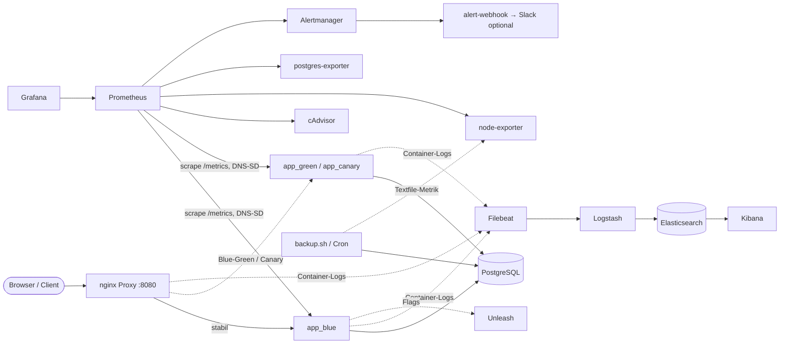
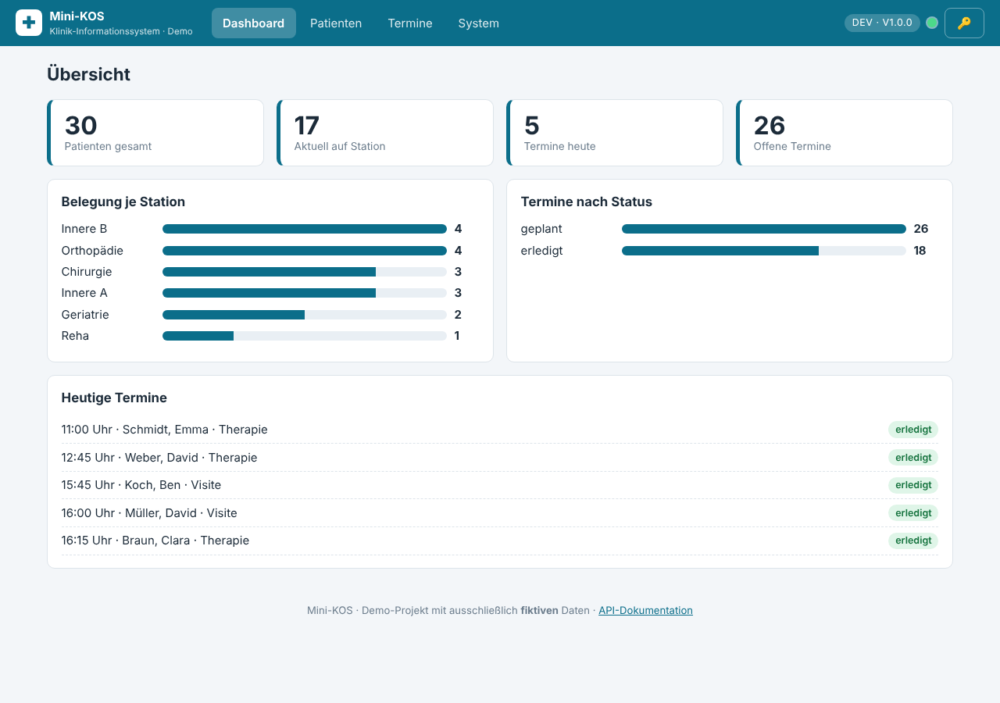

# Mini-KOS

**Demo eines Klinik-Informationssystems (KIS) mit vollständiger DevOps-Lieferkette** – komplett On-Premise, ohne Cloud und ohne Kubernetes.
Die Fachanwendung ist bewusst klein (Patienten, Aufenthalte, Termine); der Schwerpunkt liegt auf dem Betrieb drumherum:
Container, CI/CD, Provisionierung, Deployment-Strategien, Monitoring, zentrales Logging, Feature Flags, Backup/Restore und Supportprozesse.

> ⚠️ **Alle Daten sind fiktiv.** Das Projekt ist ein Demo-/Lernprojekt und kein zertifiziertes Medizinprodukt. Siehe [Sicherheit & Datenschutz](docs/SICHERHEIT-DATENSCHUTZ.md).

---

## Inhalt

| Modul | Was es zeigt | Wo |
|---|---|---|
| **Anwendung** | FastAPI + PostgreSQL, REST-API, Health/Readiness, strukturierte JSON-Logs | `app/` |
| **Web-GUI** | Dashboard, Patientenverwaltung, Termine, Systemstatus (ohne Framework, XSS-sicher) | `app/static/` |
| **Container** | Multi-Stage-Dockerfile, non-root, Healthcheck, BuildKit-Cache | `Dockerfile` |
| **Orchestrierung** | Docker Compose mit Profilen + Overrides für dev/test/prod, nginx-Proxy | `docker-compose*.yml`, `nginx/` |
| **CI/CD** | **GitHub Actions** und GitLab CI: Lint ∥ Test → Build → Trivy-Scan → Deploy (Test auto, Prod manuell mit Freigabe) | `.github/workflows/`, `.gitlab-ci.yml` |
| **Provisionierung** | Ansible: Docker-Host, Deployment, Backup-Cron, Review-Umgebungen | `ansible/` |
| **Deployment-Strategien** | Blue-Green, Rolling, Canary, Recreate + Rollback | `scripts/deploy_*.sh` |
| **Monitoring** | Prometheus, Alertmanager (Routing nach Schweregrad), Grafana-Dashboard, cAdvisor, node-/postgres-exporter | `monitoring/` |
| **Logging** | ELK (Filebeat → Logstash mit Daten-Schwärzung → Elasticsearch → Kibana), 14-Tage-Retention | `elk/` |
| **Feature Flags** | Unleash mit Fallback auf Umgebungsvariablen | `app/flags.py` |
| **Backup/Restore** | `pg_dump` + Integritätsprüfung + Retention + **Restore-Test** + Prometheus-Metrik | `scripts/backup.sh` u. a. |
| **Security-Scan** | Trivy (Image + Config) als Pipeline-Gate | `.gitlab-ci.yml` |
| **Pipeline-Cache-Report** | Wertet GitLab-API aus: Cache HIT vs. MISS (CSV + Diagramm) | `scripts/pipeline_cache_report.py` |
| **Support-Simulation** | 4 Störfälle zum Üben, mit Alarm-Auslösern | `docs/SUPPORT-SZENARIEN.md` |

## Architektur



Details: [docs/ARCHITEKTUR.md](docs/ARCHITEKTUR.md)

## Schnellstart

```bash
make help            # alle Befehle
make ci              # lokal dasselbe wie die CI (Lint, Tests, Image-Build, Compose-Prüfung)
make github-push REPO=deinname/mini-kos CREATE=1   # Repository auf GitHub anlegen und pushen → Actions starten
```

### Variante A – nur die App, ohne Docker (30 Sekunden)

```bash
make venv          # virtuelle Umgebung + Abhängigkeiten
make test          # 26 Tests
make run           # startet mit SQLite + Demo-Daten → http://localhost:8000
```

### Variante B – kompletter Stack mit Docker

Voraussetzungen: Docker ≥ 24 mit Compose-Plugin, ~4 GB freier RAM (ohne ELK), ~8 GB (mit ELK).

```bash
make up              # db + app + proxy                    → http://localhost:8080
make seed            # 40 fiktive Patienten laden
make up-monitoring   # Prometheus, Grafana, Alertmanager … → http://localhost:3000 (admin/admin)
make smoke           # Rauchtest
make up-elk          # (optional) ELK                       → http://localhost:5601
make up-flags        # (optional) Unleash                   → http://localhost:4242
make down            # alles stoppen (Daten bleiben)
```

Port belegt? In `.env` ändern (`make setup` legt die Datei an): `PROXY_PORT`, `PROMETHEUS_PORT`, `GRAFANA_PORT`, …

### Ports und Zugänge

| Dienst | URL | Login |
|---|---|---|
| **Mini-KOS (GUI)** | http://localhost:8080 | – (optional API-Key) |
| API-Doku (Swagger) | http://localhost:8080/docs | – |
| Grafana | http://localhost:3000 | admin / admin (**Demo!**) |
| Prometheus | http://localhost:9090 | – |
| Alertmanager | http://localhost:9093 | – |
| Kibana | http://localhost:5601 | – (Security aus, nur Demo) |
| Unleash | http://localhost:4242 | admin / unleash4all (**Demo!**) |

## Die GUI



Vier Bereiche, deutsche Oberfläche, Statuspunkt oben rechts (grün = Datenbank erreichbar):

- **Dashboard** – Kennzahlen (Patienten, aktuell auf Station, Termine heute/offen), Belegung je Station, heutige Termine. Die zusätzlichen Karten hängen am Feature Flag `neues_dashboard`, das Wartungsbanner am Flag `wartungshinweis`.
- **Patienten** – Suche nach Name/Fallnummer, Liste links, Detailansicht rechts mit Aufenthalten und Terminen; Anlegen, Bearbeiten, Löschen, Entlassen.
- **Termine** – alle Termine, Filter nach Status, Status ändern (erledigt/abgesagt).
- **System** – Version, Git-SHA, Umgebung, **welche Instanz antwortet** (blue/green/canary), Health-Checks, Feature Flags, Links zu Grafana/Kibana usw. In dev/test zusätzlich die **Störungs-Simulation** (HTTP-500, langsame Antwort).

Mit gesetztem `API_KEY` brauchen Schreibzugriffe den Key – in der GUI über das 🔑-Symbol einzutragen. Mehr: [docs/GUI-ANLEITUNG.md](docs/GUI-ANLEITUNG.md).

## REST-API (Auszug)

| Methode | Pfad | Zweck |
|---|---|---|
| GET/POST | `/api/patients` | Liste (`?q=`, `limit`, `offset`, Header `X-Total-Count`) / anlegen |
| GET/PUT/DELETE | `/api/patients/{id}` | lesen / ändern / löschen (kaskadiert) |
| GET/POST | `/api/stays` · POST `/api/stays/{id}/entlassen` | Aufenthalte |
| GET/POST | `/api/appointments` · PATCH `/{id}/status` | Termine |
| GET | `/api/stats` · `/api/version` · `/api/flags` | Kennzahlen, Version, Flags |
| GET | `/health` · `/ready` · `/metrics` | Liveness, Readiness (DB), Prometheus |

## Deployment-Strategien kurz

```bash
make bluegreen TAG=1.1.0      # parallel starten, prüfen, atomar umschalten    → make rollback
make rolling   TAG=1.1.0      # Replikas einzeln austauschen, keine Downtime
make canary    TAG=1.1.0      # 10 % Traffic → make canary-promote | canary-abort
make recreate  TAG=1.1.0      # stoppen + starten (kurze Downtime, einfach)
```

Entscheidungshilfe, Abläufe und Grenzen: [docs/DEPLOYMENT-STRATEGIEN.md](docs/DEPLOYMENT-STRATEGIEN.md)

## Alarmkette ausprobieren

```bash
make up up-monitoring
make load                # normale Last → Grafana-Kurven füllen sich
make alerts-errors       # HTTP-500 → HighErrorRate (nach ~2 Min.) → Alertmanager → alert-webhook
make alerts-down         # App stoppen → AppDown / AppAbsent
docker compose logs -f alert-webhook
```

## Projektstruktur

```
mini-kos/
├── app/                    FastAPI-App (routers/, models, schemas, metrics, flags, seed) + static/ (GUI)
├── tests/                  pytest (API, Sicherheit, Flags, Cache-Report)
├── Dockerfile              Multi-Stage, non-root, Healthcheck
├── docker-compose.yml      Basis + Profile; *.dev/test/prod.yml = Overrides
├── nginx/conf.d/           Proxy + dynamisches Routing (von Skripten geschrieben)
├── monitoring/             Prometheus, Alert-Regeln, Alertmanager, Webhook, Grafana-Provisioning + Dashboard
├── elk/                    Logstash-Pipeline, Filebeat, ILM-Setup
├── ansible/                Inventories (dev/test/prod), Rollen docker_host + mini_kos, Playbooks
├── scripts/                deploy_*.sh, rollback, backup/restore, smoke, trigger_alerts, cache-report
├── env/                    Umgebungsdateien (prod.env nur als .example)
├── docs/                   Dokumentation (siehe unten)
├── .github/                GitHub Actions (ci, deploy, security), Dependabot
├── .gitlab-ci.yml          GitLab-Pipeline (gleicher Ablauf)
└── Makefile                Komfortbefehle (`make help`)
```

## Dokumentation

| Dokument | Inhalt |
|---|---|
| [ARCHITEKTUR](docs/ARCHITEKTUR.md) | Komponenten, Datenfluss, Entwurfsentscheidungen |
| [BETRIEB](docs/BETRIEB.md) | Start/Stopp, Backup & Restore, Updates, Geheimnisse, Fehlersuche |
| [DEPLOYMENT-STRATEGIEN](docs/DEPLOYMENT-STRATEGIEN.md) | Blue-Green, Rolling, Canary, Recreate im Vergleich |
| [CI-CD](docs/CI-CD.md) | GitHub Actions und GitLab CI: Ablauf, Einrichtung, Caching, Vier-Augen-Prinzip, Trivy |
| [MONITORING](docs/MONITORING.md) | Metriken, Alert-Regeln, Routing, Dashboards, ELK |
| [SUPPORT-SZENARIEN](docs/SUPPORT-SZENARIEN.md) | 4 Störfälle zum Üben, jeweils mit Diagnose und Lösung |
| [SICHERHEIT-DATENSCHUTZ](docs/SICHERHEIT-DATENSCHUTZ.md) | Schutzmaßnahmen, bewusste Demo-Abkürzungen, To-dos für echten Betrieb |
| [GUI-ANLEITUNG](docs/GUI-ANLEITUNG.md) | Bedienung der Oberfläche |
| [PITCH](docs/PITCH.md) | 3-Minuten-Vorstellung des Projekts + typische Rückfragen |

## Teststatus (ehrlich)

| Bereich | Status |
|---|---|
| App/API/GUI-Auslieferung | ✅ pytest (grün), ruff (sauber), JS-Syntax geprüft |
| Shell-Skripte | ✅ shellcheck sauber; Deploy-Logik (Blue-Green/Rollback/Canary/Rolling/Recreate) mit Docker-Attrappe durchgespielt |
| Ansible | ✅ `--syntax-check` aller Playbooks; ❌ nicht gegen echten Host gelaufen |
| GitHub-Workflows | ✅ `actionlint` sauber; ❌ noch nicht auf GitHub gelaufen |
| Compose / YAML / Dashboard-JSON | ✅ `docker compose config`, yamllint, JSON valide |
| Container-Betrieb (Compose-Stack, ELK, Unleash, Grafana-Rendering, GitLab-Pipeline) | ⚠️ **nicht ausgeführt** (in der Erstellungsumgebung gab es keinen Docker-Daemon) – bitte beim ersten Start mit `make up` prüfen und Auffälligkeiten melden |

## Häufige Stolpersteine

- **Port belegt** (`bind: address already in use`): alte Container (`docker ps`, `make down`) oder Ports in `.env` ändern.
- **Elasticsearch startet nicht**: `sudo sysctl -w vm.max_map_count=262144`.
- **Grafana-Dashboard leer**: erst `make up-monitoring`, dann Last erzeugen (`make load`); Zeitraum oben rechts prüfen.
- **`env/prod.env not found`** bei `DEPLOY_ENV=prod`: Vorlage `env/prod.env.example` kopieren (auf Servern erledigt Ansible das).
- **Backup-Alarm direkt nach dem Start**: gewollt – erst `make backup` ausführen, dann verschwindet `BackupMetricMissing`.

## Lizenz / Hinweis

Lern- und Demonstrationsprojekt. Verwendung auf eigene Verantwortung; nicht für echte Patientendaten ohne die in [SICHERHEIT-DATENSCHUTZ](docs/SICHERHEIT-DATENSCHUTZ.md) genannten Maßnahmen.
