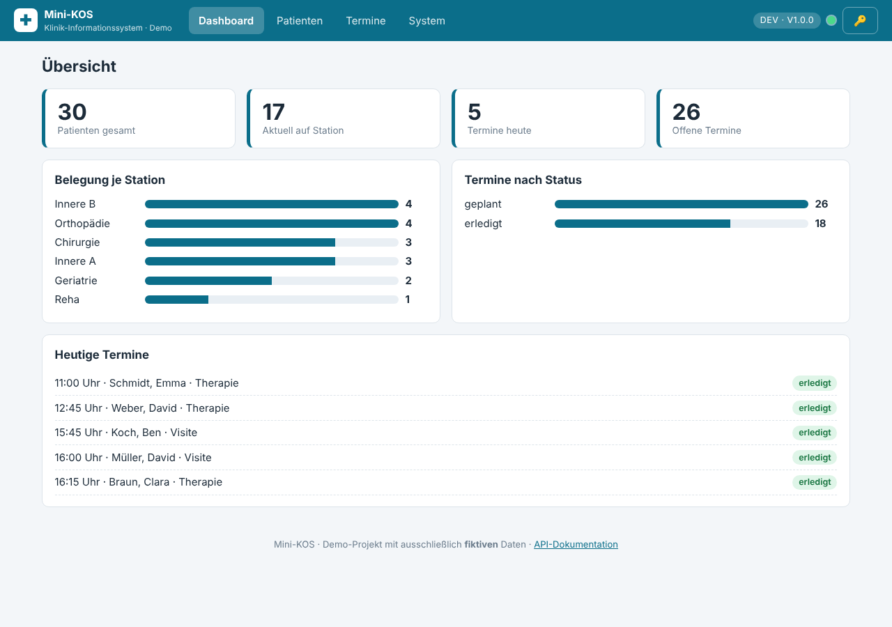
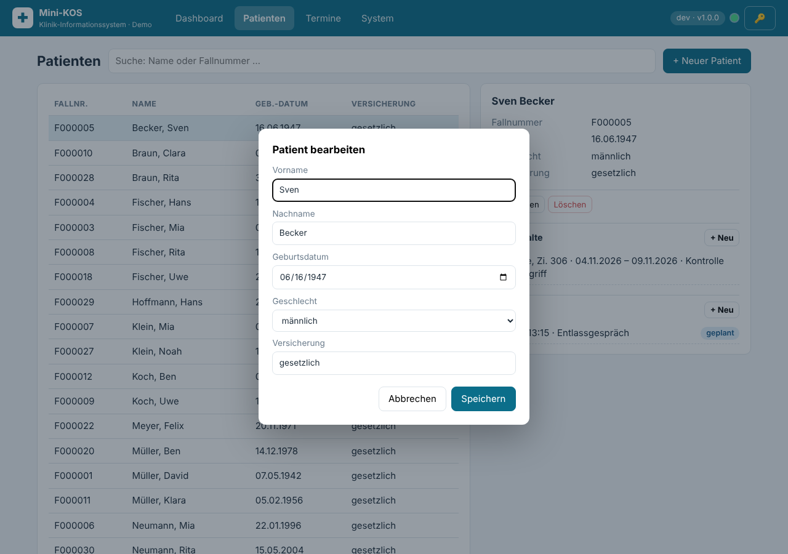
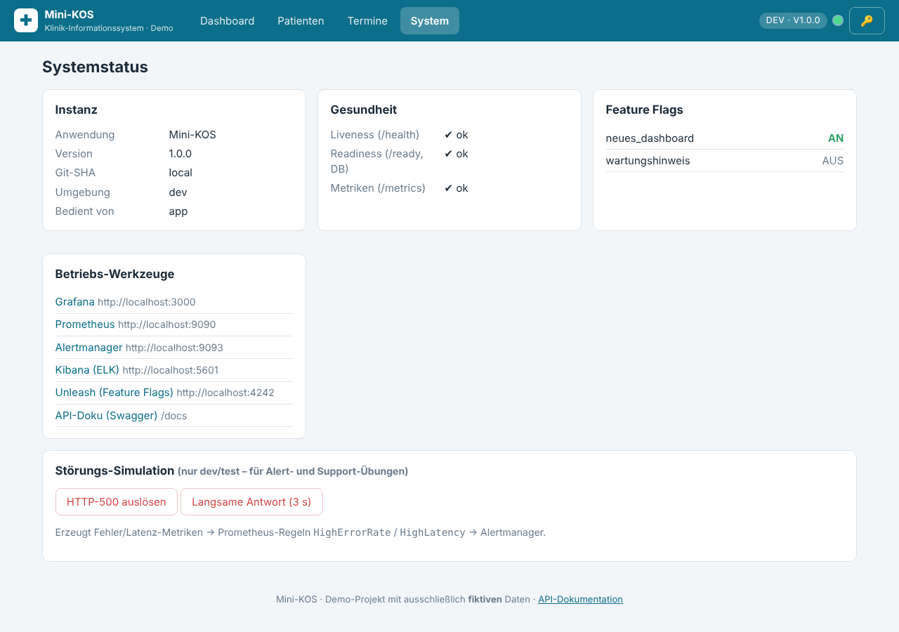

# GUI-Anleitung

Aufruf: `http://localhost:8080` (Docker) bzw. `http://localhost:8000` (`make run`).

## Kopfzeile

- **Reiter:** Dashboard · Patienten · Termine · System
- **Badge:** Umgebung und Version (z. B. `dev · v1.0.0`)
- **Statuspunkt:** grün = System bereit (Datenbank erreichbar), rot = nicht bereit (prüft alle 10 s `/ready`)
- **🔑:** API-Key eintragen, falls der Server mit `API_KEY` läuft (nur in dieser Browser-Sitzung gespeichert)
- **Gelbes Banner:** Wartungshinweis – erscheint, wenn das Flag `wartungshinweis` aktiv ist

## Dashboard
Kennzahlen: Patienten gesamt · aktuell auf Station · Termine heute · offene Termine.
Darunter Belegung je Station und Termine nach Status (nur sichtbar mit Flag `neues_dashboard`) sowie die Liste der heutigen Termine.

## Patienten
1. **Suchen:** Name oder Fallnummer eintippen (Suche startet automatisch).
2. **Anlegen:** „+ Neuer Patient“ → Formular → Speichern. Die Fallnummer wird vergeben und angezeigt.
3. **Auswählen:** Zeile anklicken → rechts Details, Aufenthalte, Termine.
4. **Aufenthalt:** „+ Neu“ bei Aufenthalte (Station, Zimmer, Aufnahme, Diagnose). „Entlassen“ setzt das heutige Datum.
5. **Termin:** „+ Neu“ bei Termine (Datum/Uhrzeit, Art, Bemerkung).
6. **Bearbeiten/Löschen:** Schaltflächen im Detailbereich; Löschen entfernt auch Aufenthalte und Termine (mit Rückfrage).

Fehler (z. B. ungültiges Datum, fehlender API-Key) erscheinen als rote Hinweise unten rechts.

## Termine
Alle Termine chronologisch, Filter nach Status. Je Zeile: auf „erledigt“ oder „abgesagt“ setzen, löschen (✕).

## System
- **Instanz:** Version, Git-SHA, Umgebung und **„Bedient von“** (blue/green/canary) – ideal, um Deployments und Canary-Verteilung zu beobachten (Seite neu laden bzw. mehrfach aufrufen).
- **Gesundheit:** Liveness, Readiness (DB), Metrik-Endpunkt (über den Proxy bewusst gesperrt → zeigt ✖).
- **Feature Flags:** aktueller Stand (AN/AUS).
- **Betriebs-Werkzeuge:** Links zu Grafana, Prometheus, Alertmanager, Kibana, Unleash, Swagger.
- **Störungs-Simulation** (nur dev/test): HTTP-500 auslösen bzw. 3 s verzögerte Antwort – zum Üben der Alarmkette.

## Barrierefreiheit und Technik
Tastaturbedienbar (Standard-HTML-Elemente, Dialoge per `<dialog>`), kontrastreiche Farben, responsives Layout (Tabelle scrollt auf kleinen Bildschirmen). Kein Build-Schritt, keine externen Bibliotheken oder Schriften – funktioniert im geschlossenen Netz.
